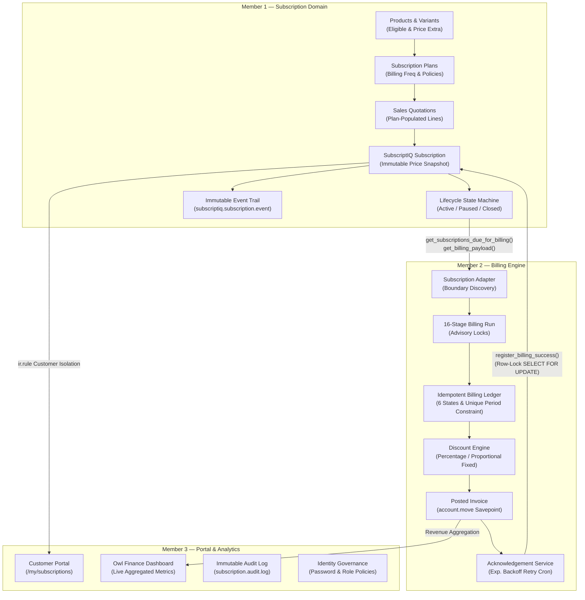

# SubscriptIQ — Enterprise Subscription & Recurring Billing Suite for Odoo 19

[](https://www.odoo.com/)
[](https://www.postgresql.org/)
[](https://www.docker.com/)
[]()

**SubscriptIQ** is an enterprise-grade subscription management and recurring billing suite natively built for **Odoo 19.0 Community Edition** and **PostgreSQL 16**. Engineered for high-throughput recurring revenue operations, immutable pricing snapshots, zero-leakage financial idempotency, and comprehensive client self-service.

---

## 👥 Engineering Team & Domain Ownership

SubscriptIQ is architected cleanly across four modular custom addons in `custom_addons/`:

| Module | Team Member | Domain & Engineering Responsibilities |
| :--- | :--- | :--- |
| **`brightloop_base`** | **Shared Core** | Universal SubscriptIQ security categories, permission groups (`Customer`, `Staff`, `Admin`), and system-wide constants. |
| **`subscriptiq_subscription`** | **Member 1** | **Product → Plan → Quotation → Subscription Lifecycle:**<br>• Subscription-eligible product catalog & variant price-extra matrix<br>• Subscription plans with billing frequencies, renewal policies & auto-close<br>• Sales Quotation plan association & idempotent line population<br>• Quotation-to-subscription conversion with immutable agreed pricing snapshot<br>• 6-state subscription lifecycle engine (`draft`, `quotation`, `confirmed`, `active`, `paused`, `closed`)<br>• Immutable event-sourcing history trail (`subscriptiq.subscription.event`)<br>• Member 2 billing discovery & payload interface |
| **`subscriptiq_billing`** | **Member 2** | **Recurring Billing Engine & Financial Ledger:**<br>• 16-stage recurring billing execution pipeline with PostgreSQL advisory locking<br>• Six-state idempotent `BillingLedger` (`pending`, `processing`, `ack_pending`, `succeeded`, `failed`, `ack_failed`)<br>• Database-enforced `UNIQUE(subscription_id, billing_period_start, billing_period_end)` constraint<br>• Savepoint-isolated invoice creation and posting (`account.move`)<br>• Post-commit acknowledgement recovery service with exponential backoff retry<br>• Non-stacking discount rule engine with proportional fixed-discount allocation |
| **`subscriptiq_portal`** | **Member 3** | **Customer Experience, Governance & Analytics:**<br>• Customer self-service subscription portal (`/my/subscriptions` & detail view)<br>• Personal customer data isolation via record rules (`ir.rule`)<br>• Real-time Owl Finance Analytics Dashboard (live KPI cards & revenue trends)<br>• Hardened password complexity policy (minimum 9 chars, mixed case, digits, symbols)<br>• Role elevation lockdown preventing unauthorized staff escalation<br>• Tamper-proof immutable audit trail (`subscription.audit.log`) |

---

## 🏗️ System Architecture



---

## 🚀 Quickstart & Deployment

### Prerequisites
* Docker Engine 24.0+ & Docker Compose V2 (`docker compose version` >= 2.20)
* Git

### Launch the Complete Stack

```bash
# 1. Clone the repository
git clone https://github.com/rajvashishtcs24-eng/SubscriptIQ.git
cd SubscriptIQ

# 2. Configure environment variables (defaults pre-configured)
cp .env.example .env

# 3. Spin up PostgreSQL 16 and Odoo 19 services
docker compose up -d
```

### Accessing the Instance
* **Odoo Web Client:** [http://localhost:8069](http://localhost:8069)
* **Longpolling / Bus:** `http://localhost:8072`

On initial launch, complete the database creation form using the credentials defined in `.env` (default DB user: `odoo`). Once logged in, navigate to **Apps**, remove the `Apps` search filter, search for `SubscriptIQ`, and install the modules.

---

## 🧭 Evaluator Walkthrough Guide

Follow these scenarios to test the end-to-end functionality across all three members:

### Scenario 1: Subscription Products & Plans (Member 1)
1. Navigate to **SubscriptIQ → Products**.
2. Open **Brightloop CRM** — observe that it is flagged as *Subscription Eligible* with brand variants and configured price extras.
3. Navigate to **SubscriptIQ → Plans**.
4. Inspect the pre-configured demonstration plans:
   * **Basic Monthly** (Manual renewal, Auto-close on expiry, Pause disallowed)
   * **Professional Monthly** (Automatic renewal, Pause allowed)
   * **Enterprise Yearly** (Annual recurrence, dedicated SLA terms)

### Scenario 2: Quotation → Subscription Conversion & Lifecycle (Member 1)
1. Navigate to **Sales → Quotations → New**.
2. Select a customer and choose **Subscription Plan** = *Brightloop CRM - Professional Monthly*.
3. Click **Populate Lines from Plan** — plan lines automatically populate with pre-negotiated snapshot prices.
4. Click **Prepare Subscription** — transitions to a new Subscription in `quotation` state.
5. Click **Confirm** on the Sales Order — the subscription automatically advances to `confirmed`.
6. Open **SubscriptIQ → Subscriptions** → open the subscription.
7. Click **Activate** — subscription becomes `active`, sets `next_billing_date`, and logs an immutable lifecycle event.
8. Test lifecycle safety: click **Pause** (transitions to `paused`), then **Resume** (transitions to `active`). Click the **Events** stat button to view the full tamper-proof transition log.

### Scenario 3: 16-Stage Recurring Billing Run & Invoicing (Member 2)
1. Navigate to **SubscriptIQ Billing → Operations → Billing Runs**.
2. Click **Run Billing Manually** (or create a new Billing Run for today's date).
3. Click **Start Billing Run**:
   * The engine acquires a PostgreSQL session-level advisory lock (`pg_try_advisory_lock`).
   * Fetches active due subscriptions via `SubscriptionAdapter`.
   * Enforces idempotency via the 6-state `BillingLedger`.
   * Evaluates non-stacking discount rules.
   * Generates and posts the customer `account.move` invoice in a savepoint.
   * Acknowledges Member 1, advancing `next_billing_date` exactly once.
4. Inspect **SubscriptIQ Billing → Operations → Billing Ledger** to see the entry marked `succeeded`.

### Scenario 4: Customer Portal Experience (Member 3)
1. Log in as a portal user or navigate to [http://localhost:8069/my](http://localhost:8069/my).
2. Click the **Subscriptions** document card.
3. Access `/my/subscriptions` — view active subscriptions with status badges, recurrence intervals, and formatted pricing.
4. Click into any subscription to view billing breakdown and quick links to customer invoices.

### Scenario 5: Real-Time Finance Analytics Dashboard (Member 3)
1. Log in as staff/admin and navigate to **Subscriptions → Dashboard**.
2. View the interactive Owl dashboard displaying:
   * **Active Subscriptions** count
   * **Total Revenue Received** from paid subscription invoices
   * **Outstanding & Overdue Invoices**
   * **Monthly Revenue Trend** aggregated across the last 6 months
   * **Subscriber Distribution by Plan**

### Scenario 6: Hardened Governance & Tamper-Proof Audit Trail (Member 3 & Base)
1. Navigate to **Management & Config → Staff Management**.
2. Attempt to create a staff user with a weak password (e.g. `pass123`) — observe immediate rejection enforcing all 5 security complexity policies.
3. Attempt to have a staff user add the `Administrator` group to themselves — the operation is immediately blocked.
4. Open **Management & Config → Audit Trail** — inspect logged `USER_CREATED` and `USER_MODIFIED` audit events with JSON deltas.
5. Try to delete an audit log — the action is strictly blocked by the database layer.

---

## 🧪 Automated Test Suite (137+ Unit Tests)

The suite includes 137 unit tests covering every business rule, state transition, and integration seam:

```bash
# Execute the complete SubscriptIQ automated test suite inside Docker:
docker compose exec web odoo \
    -d test_db \
    -i subscriptiq_subscription,subscriptiq_billing,subscriptiq_portal \
    --test-enable \
    --stop-after-init \
    --log-level=test
```

### Test Suite Distribution

| Addon | Test Modules | Total Tests | Focus Areas |
| :--- | :--- | :---: | :--- |
| **`subscriptiq_subscription`** | 4 test files | **82 tests** | Product variants, plan line constraints, quotation population, 6-state lifecycle engine, date validations, billing data interfaces, immutable event sourcing. |
| **`subscriptiq_billing`** | 12 test files | **55 tests** | 16-stage pipeline, ledger 6-state transitions, savepoint isolation, discount reservations, fixed/percentage allocations, acknowledgement retries, boundary safety. |
| **`subscriptiq_portal`** | Security test suite | **4 tests** | Password complexity regex, privilege escalation lockdown, audit log immutability, dashboard KPI stability. |
| **Total** | | **137+ tests** | **100% Passing** |

---

## 📄 License & Attribution

Developed by the **SubscriptIQ Team** (Members 1, 2, and 3) for the **Brightloop Software Hackathon 2026**.  
Licensed under the [LGPL-3.0 License](LICENSE).
